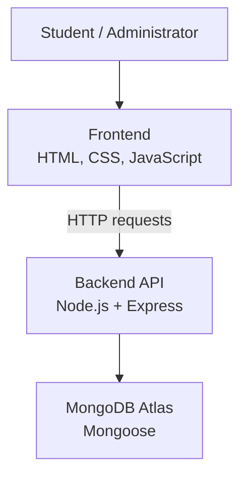

# 📚 LibTrack
### Every book. Within reach.

A full-stack college library management system that helps students discover books, check availability, locate shelves, and track borrowing — while giving administrators tools to manage library operations.

[**Live Demo ↗**](https://libtrack-pi.vercel.app/) · [Backend API](https://libtrack-nvh6.onrender.com) · [GitHub Repository](https://github.com/ismail01098/LibTrack)


---

## The idea

Finding a book in a college library shouldn't mean wasting time asking whether it's available or searching shelf after shelf.

**LibTrack brings book discovery, availability, shelf locations, and borrowing information into one place.**

The goal is simple: make the library easier for students to navigate and easier for administrators to manage.

## Explore the features

### For students

- **Discover books** — Search by title, author, ISBN, or category.
- **Check availability** — View available copies and book status.
- **Find the shelf** — Check rack and shelf locations.
- **Track borrowing** — View borrowed books, due dates, and borrowing history.
- **Manage your account** — Register, log in, and view your profile.
- **Stay organized** — View due-soon information and borrowing summaries.

### For administrators

- **Manage the catalog** — Add, edit, and delete books.
- **Manage students** — View and maintain student records.
- **Handle borrowing** — Issue and return books.
- **Monitor activity** — Review borrowing and overdue information.
- **Upload book covers** — Add cover images to catalog entries.

## The workflow

```text
SEARCH
   ↓
CHECK AVAILABILITY
   ↓
FIND RACK / SHELF
   ↓
BORROW
   ↓
TRACK RETURN DATE
```

A straightforward flow designed around the everyday library experience.

## Under the hood

LibTrack uses a separate frontend, backend API, and database.



### Technology stack

| Layer | Technologies |
|---|---|
| Frontend | HTML, CSS, JavaScript |
| API communication | Fetch API |
| Backend | Node.js, Express.js |
| Database | MongoDB Atlas, Mongoose |
| Authentication | JWT, bcryptjs |
| File uploads | Multer |
| Configuration | dotenv, CORS |
| Version control | Git, GitHub |
| Deployment | Vercel, Render |

## Security

- Password hashing with bcryptjs.
- JWT-based authentication.
- Role-based access for students and administrators.
- Protected administrative operations.

## Run locally

### Requirements

- Node.js and npm
- MongoDB database access
- Git

### 1. Clone the repository

```bash
git clone https://github.com/ismail01098/LibTrack.git
cd LibTrack
```

### 2. Install dependencies

```bash
npm install
```

### 3. Configure environment variables

Create a `.env` file in the location expected by your backend configuration.

Add the required MongoDB connection string and JWT secret using the exact environment variable names your code expects.

**Never commit `.env` files, credentials, or secrets to GitHub.**

### 4. Start the backend

If `backend/server.js` is your configured entry point, run:

```bash
node backend/server.js
```

### 5. Launch the frontend

Serve the `frontend` directory using a local development server. Make sure the frontend's API URL points to your local backend.

## What I learned

Building LibTrack helped me explore:

- Full-stack web application development.
- Frontend-to-backend API communication.
- Database modeling with MongoDB and Mongoose.
- Authentication and role-based authorization.
- Book inventory and borrowing workflows.
- Backend deployment and frontend integration.
- Version control with Git and GitHub.

## What's next?

Ideas for future development include:

- Automated due-date reminders.
- Notifications when requested books become available.
- QR codes for faster book location.
- Cloud-based book cover storage.
- Further improvements to mobile responsiveness and accessibility.

## About the developer

**Ismail Shahal**  
Second-year BCA student interested in software development, practical problem-solving, and building useful applications.

[GitHub Profile ↗](https://github.com/ismail01098)

---

*LibTrack is an educational project developed to explore full-stack web development and improve everyday library workflows.*
